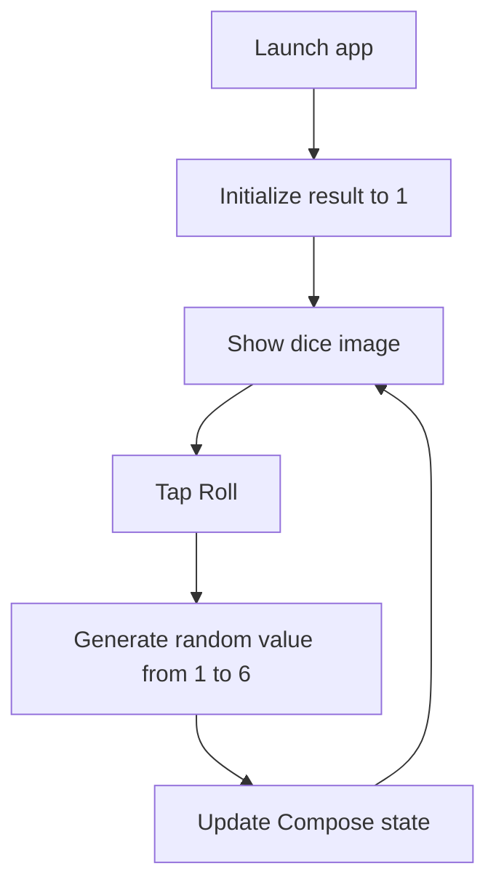

# DiceRoller — Android Dice Rolling App

A small Android application that simulates rolling **one six-sided die**. Tap **Roll** to generate a random value between 1 and 6; the corresponding dice illustration updates immediately.

Built with **Kotlin** and **Jetpack Compose**, this project focuses on reactive UI state, drawable resources, and basic Android application structure.

> **Project scope:** The current source implements one standard six-sided die. It **does not** include multiple dice, configurable numbers of sides, a roll history, or dice-roll animations. Those features appeared in an earlier README but are not implemented in the checked-in app.

## Features

- **Single dice roll:** a button draws a random integer from `1..6`.
- **Visual result:** one of six drawable dice faces is displayed for the current value.
- **Declarative UI:** Compose redraws the image when the stored result changes.
- **Material 3 button and theme:** system-aware light/dark color schemes, with dynamic color on supported Android 12+ devices.
- **Minimal interface:** a centered dice image with a **Roll** button beneath it.

The app opens with the die showing **1**. Rolling can produce the same result as the previous roll; this is expected for a random draw.

## How it works

The UI and rolling logic are implemented in [`MainActivity.kt`](app/src/main/java/com/example/diceroller/MainActivity.kt).

```kotlin
var result by remember { mutableStateOf(1) }

// Choose the image resource for the current result.
val imageResource = when (result) {
    1 -> R.drawable.dice_1
    2 -> R.drawable.dice_2
    3 -> R.drawable.dice_3
    4 -> R.drawable.dice_4
    5 -> R.drawable.dice_5
    else -> R.drawable.dice_6
}

// Called when the user taps the Roll button.
result = (1..6).random()
```

The complete screen contains a `Column` with an `Image`, a 16 dp spacer, and a Material 3 `Button`. Its state is held with `remember { mutableStateOf(...) }`, which triggers recomposition when changed.

**State limitation:** this uses `remember` rather than `rememberSaveable` or persistent storage. The current roll should not be assumed to survive activity recreation or process termination.

### App flow



## Technology stack

| Component | Technology / version in source |
| --- | --- |
| Language | Kotlin **2.0.0** |
| Platform | Native Android |
| UI | Jetpack Compose with Material 3 |
| Build system | Gradle Wrapper **8.9**, Android Gradle Plugin **8.7.2** |
| Android SDK | `compileSdk = 35`, `targetSdk = 35`, `minSdk = 24` |
| Java compatibility | Java **11** source/target and JVM target |
| Activity integration | AndroidX Activity Compose |
| Testing scaffolds | JUnit 4, AndroidX instrumentation testing |

The versions above are taken from [`gradle/libs.versions.toml`](gradle/libs.versions.toml), [`app/build.gradle.kts`](app/build.gradle.kts), and the Gradle wrapper configuration.

## Getting started

### Requirements

- Android Studio with support for the project's Kotlin and Android Gradle Plugin versions.
- Android SDK Platform **35** installed.
- JDK compatible with Android Gradle Plugin 8.7.2 (typically **JDK 17** for running Gradle; the generated app targets Java 11 language compatibility).
- An Android emulator or physical device running **Android 7.0 (API 24)** or later.

### Open in Android Studio

1. Clone the repository:

   ```bash
   git clone https://github.com/alfrzhb/DiceRoller.git
   cd DiceRoller
   ```

2. Open the **DiceRoller** project directory in Android Studio.
3. Let Gradle sync and download the required dependencies.
4. Select the `app` run configuration.
5. Choose an emulator or connected Android device and press **Run**.
6. Tap **Roll** to update the displayed dice face.

The app has no backend, database, external API, user login, or environment secrets to configure.

### Build from the command line

Run the included Gradle wrapper from the repository root.

**macOS / Linux**

```bash
./gradlew assembleDebug
./gradlew testDebugUnitTest
```

**Windows (PowerShell or Command Prompt)**

```powershell
.\gradlew.bat assembleDebug
.\gradlew.bat testDebugUnitTest
```

The debug APK is normally produced under `app/build/outputs/apk/debug/` after a successful build.

To run instrumentation tests on a connected device or running emulator:

```bash
./gradlew connectedDebugAndroidTest
```

These are **standard Gradle tasks**, not evidence of successful execution: building and running the app were not part of this README-only audit.

## Project structure

```text
DiceRoller/
├── README.md
├── build.gradle.kts
├── settings.gradle.kts
├── gradle/
│   ├── libs.versions.toml          # Dependency and plugin versions
│   └── wrapper/                    # Gradle Wrapper 8.9
├── gradlew
├── gradlew.bat
└── app/
    ├── build.gradle.kts            # Android module configuration
    └── src/
        ├── main/
        │   ├── AndroidManifest.xml
        │   ├── java/com/example/diceroller/
        │   │   ├── MainActivity.kt  # Dice UI and random roll logic
        │   │   └── ui/theme/       # Compose colors, theme, typography
        │   └── res/
        │       ├── drawable/
        │       │   ├── dice_1.xml
        │       │   ├── ...
        │       │   └── dice_6.xml
        │       └── values/
        │           └── strings.xml
        ├── test/                    # Example local unit test
        └── androidTest/             # Example instrumentation test
```

## Testing status

The repository contains the default Android Studio-style example tests:

- [`ExampleUnitTest.kt`](app/src/test/java/com/example/diceroller/ExampleUnitTest.kt) verifies `2 + 2 = 4`.
- [`ExampleInstrumentedTest.kt`](app/src/androidTest/java/com/example/diceroller/ExampleInstrumentedTest.kt) checks the application's package name.

**Neither test validates dice randomness or the Compose screen behavior.** There are no checked-in dedicated dice-roll tests or Compose UI interaction tests.

For more meaningful coverage, consider testing result boundaries (1–6), resource mapping, button interaction, and UI state restoration.

## Limitations and potential improvements

The following are observations from the source code, **not** runtime test results.

1. **Only one six-sided die:** rolling multiple dice and choosing custom sides are not supported.
2. **No roll animation:** the drawable swaps immediately after the button is pressed.
3. **State persistence:** the last roll is kept with `remember`, not retained through activity recreation or application restarts.
4. **No roll history or statistics:** previous results are not stored or analyzed.
5. **String-resource cleanup:** [`strings.xml`](app/src/main/res/values/strings.xml) contains an unexpected literal `x` after the `app_name` string element. Review this file and verify resource compilation.
6. **Starter tests only:** automated validation of real dice behavior has not been implemented.
7. **No packaged screenshots:** this repository does not include verified screenshots or an app-store release to link here.

Potential next steps: remove the stray resource character, move the random-value selection into a testable function, add state-restoration handling, implement Compose UI tests, and consider optional multi-dice/custom-side functionality if the project grows beyond its original learning scope.

## Project purpose

DiceRoller is a concise example of:

- Setting up a Kotlin/Jetpack Compose Android application.
- Responding to button interactions.
- Using `mutableStateOf` to drive UI recomposition.
- Mapping application state to drawable resources.
- Applying a Material 3 theme.

It is intended as an **Android learning exercise**, rather than a full-featured dice simulator.

---

**Repository:** [alfrzhb/DiceRoller](https://github.com/alfrzhb/DiceRoller) · **Default branch:** `master`

**Audit note:** This README was rewritten by inspecting the repository's Kotlin, resource, build, and test files. No source files were modified, and no build/test commands were executed as part of the documentation update.
